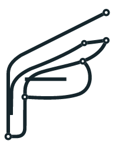
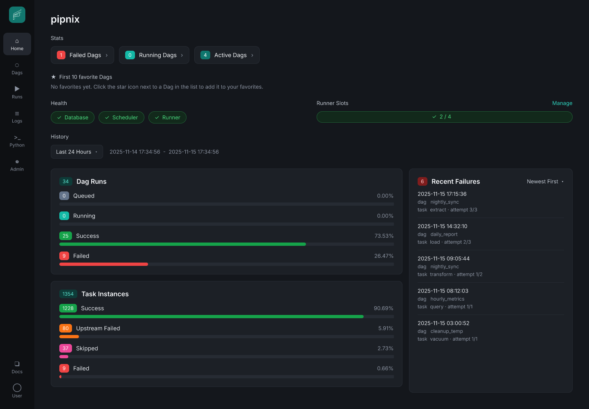
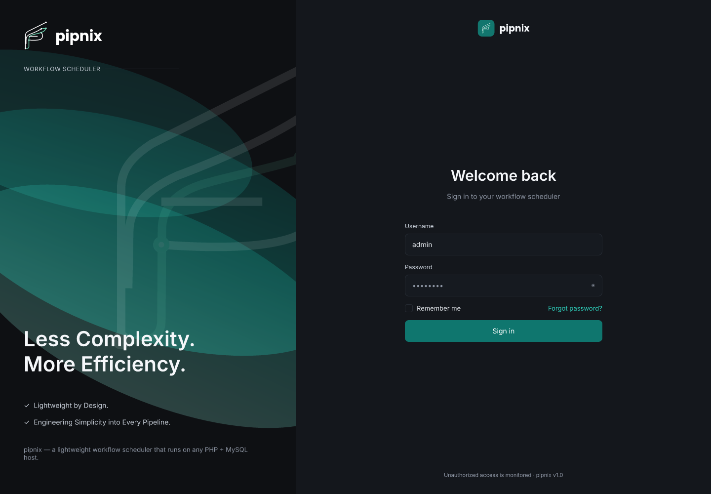
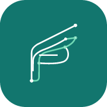

<p align="center">
  <picture>
    <source media="(prefers-color-scheme: dark)" srcset="docs/logo-white.png">
    
  </picture>
</p>

<h1 align="center">pipnix</h1>

<p align="center">
  <em>Less Complexity. More Efficiency.</em><br>
  A lightweight, <strong>Python-first</strong> workflow scheduler for cheap cPanel hosting.
</p>

<p align="center">
  
  
  
  
  
  
</p>

<p align="center">
  
</p>

---

## Why pipnix

Most schedulers assume a server. pipnix assumes a **$5 shared hosting plan**: PHP,
MySQL and one cron line. It keeps the useful 20% of Airflow — DAGs, dependencies,
retries, timeouts, run history, logs — and drops the rest.

- **Python-first DAGs** — `dags/foo.py` exposes a `DAG` dict; tasks are `func`s or commands.
- **Managed venvs** — every environment has its own interpreter and package set; no more dependency conflicts between pipelines.
- **Zero-install runner** — `lib/dag_loader.py` and `lib/runner.py` are stdlib-only and injected via `PYTHONPATH`. Nothing to `pip install`.
- **Cheap to run** — a 60-second cron tick is the whole “scheduler daemon”; no workers, no Redis, no broker.
- **Operator friendly** — retries with backoff, `upstream_failed` cascade, per-attempt logs, email alerts, an `ops.php` CLI, and a dark web console.

## How it works

```
cron (every minute)
  └─ app/scheduler.php ── tick ────────────────┬─ schedule due DAGs (cron / interval)
       │                                       ├─ cascade outcomes (upstream_failed / skipped)
       │                                       ├─ dispatch ready tasks (max_concurrency)
       │                                       └─ retries, timeouts, close runs
       ├─ app/src/DagLoader.php ──► <venv>/bin/python lib/dag_loader.py dags/*.py  (sha256 cache)
       └─ app/runner.php (detached) ─► <venv>/bin/python lib/runner.py --func jobs.mod.fn
                                      or /bin/sh -c "<command with {ds}>"
```

State lives in MySQL (`pn_dag`, `pn_task`, `pn_dag_run`, `pn_task_run`, `pn_venv`,
`pn_venv_package`, `pn_user`); logs are plain files under `logs/runs/`.

## Quick start

```bash
cp app/config.example.php app/config.php          # DB credentials + python_bin
php app/install.php --admin=admin:secret \
    --venv=reporting:/home/USER/venvs/reporting   # schema + admin + default venv
php app/dagcheck.php --file=dags/daily_report.py  # validate a DAG
php app/scheduler.php                             # one manual tick
```

Cron (one line, every minute):

```
* * * * * /usr/local/bin/php /home/USER/pipnix/app/scheduler.php >> /home/USER/pipnix/logs/cron.log 2>&1
```

Requirements: PHP 8.1+ CLI (`proc_open` allowed), MySQL 5.7+/MariaDB 10.3+,
Python 3.8+ with a venv (cPanel → *Setup Python App*).

## DAG format

```python
# dags/daily_report.py
DAG = {
    "name": "daily_report",
    "schedule": "0 3 * * *",                 # or "interval:60"
    "venv": "reporting",
    "max_concurrency": 1,
    "tasks": [
        {"name": "extract",   "func": "jobs.reporting.extract", "retries": 2, "timeout": 300},
        {"name": "transform", "func": "jobs.reporting.transform", "depends_on": ["extract"]},
        {"name": "load",      "func": "jobs.reporting.load",      "depends_on": ["transform"]},
        {"name": "publish",   "command": "python -m jobs.reporting publish --date {ds}",
         "depends_on": ["load"]},
    ],
}
```

| Task key | Meaning |
| --- | --- |
| `func` | dotted `module.function`, called with the context kwargs it declares (`ds`, `run_id`, `attempt`, `params`, `task`, `dag`); JSON return value is stored in `result_json` |
| `command` | shell string executed with the venv first on `PATH`; `{ds}` = logical date |
| `depends_on` | task names; failures cascade as `upstream_failed` |
| `retries` / `retry_delay` | extra attempts with linear backoff |
| `timeout` | seconds; enforced by both the runner and the tick |

Malformed DAGs are rejected with a precise message (`dagcheck` prints the
normalized JSON). Files are only re-executed when their sha256 changes.

## Web console

Read-only console (Phase 5) — server-rendered PHP, no build step:

```bash
php -S 127.0.0.1:8099 -t public public/index.php
# → http://127.0.0.1:8099  (sign in with the admin created by install.php)
```

Pages: **Home** (stats, health, runner slots, Dag/Task breakdowns, recent
failures), **Dags** (list + detail with task table and run-history grid),
**Runs** (filterable list + run detail and logs), **Logs** (per-attempt log
viewer), **Python** (venvs + package inventory), **Admin** (users, settings).

Deploy on cPanel: copy `public/*` to `public_html/pipnix/` (so the private
`app/` stays outside the web root), or point the document root at `public/`.
The front controller auto-detects the app directory; override with the
`PIPNIX_APP` environment variable if needed.

<table>
<tr>
<td></td>
<td></td>
</tr>
</table>

Package management (install / upgrade / requirements.txt) and the action
screens (trigger, pause, clear, DAG editor, import) arrive in Phase 6.

## CLI

```bash
php app/ops.php dags                        # schedule, active, last state
php app/ops.php runs --dag=daily_report     # recent runs
php app/ops.php tasks --run=12              # task rows of one run
php app/ops.php trigger --dag=daily_report  # manual run
php app/ops.php pause|resume --dag=...      # scheduling toggle
php app/ops.php clear --run=34              # requeue task + downstream
php app/ops.php logs --run=34 --tail=100    # tail an attempt
php app/ops.php venv:check|list|install ...  # interpreter + pip management
php app/dagcheck.php --file=dags/x.py       # validate a DAG file
```

## Tests

```bash
make check                    # PHP lint + cron/logger unit tests (no DB)
PN_MYSQL_PORT=3307 make e2e   # full integration test against a dev MySQL
```

The e2e suite provisions a real venv and database, then verifies: schema install,
pip inventory, DAG loading with hash cache, trigger → dispatch → success,
`result_json`, per-attempt logs, failure cascade, clear/rerun, pause/resume.

## Repository layout

```
app/                  scheduler.php · runner.php · ops.php · dagcheck.php · install.php
app/src/              Env, Db, Lock, Cron, DagLoader, Scheduler, Runner, Logger, Alerter
lib/                  dag_loader.py + runner.py (stdlib only)
public/               web console (index.php + views/ + assets/)
dags/ · jobs/         DAG definitions and task code
tests/                unit tests (php/) + e2e harness
docs/                 logo (dark/light), app icon, screenshots
schema.sql · Makefile · README.md
```

## Security

- Private code, DAGs, jobs and logs live **outside** the web root; entry points refuse non-CLI SAPI.
- All SQL uses prepared statements; commands are escaped with `escapeshellarg`.
- DAG files are **code** and execute at load time (same trust model as Airflow): loading is
  admin-only in the UI, runs in a subprocess with a 10s timeout, and files must live in `dags/`.
- Tasks may only use interpreters registered in `pn_venv`.
- Sessions are `HttpOnly` + `SameSite=Lax`; every POST is CSRF-checked; login throttled per session.

## Roadmap

| Phase | Scope | State |
| --- | --- | --- |
| 0 | Design system, screens, brand | done |
| 1 | Foundation (schema, Db, Lock, Cron, installer) | done |
| 2 | DAG loading (Python dict, hash cache, validation) | done |
| 3 | Execution engine (tick, runner, retries, cascade, logs) | done |
| 4 | Operator CLI + unit/e2e tests | done |
| 5 | Web console — read-only pages + auth | done |
| 6 | Web console — actions (trigger/clear), DAG editor, import, venv manager | next |
| 7 | Hardening (error pages, backups, packaging) | planned |

## License

Not chosen yet — add one before publishing (MIT or Apache-2.0 are typical for
developer tools).
